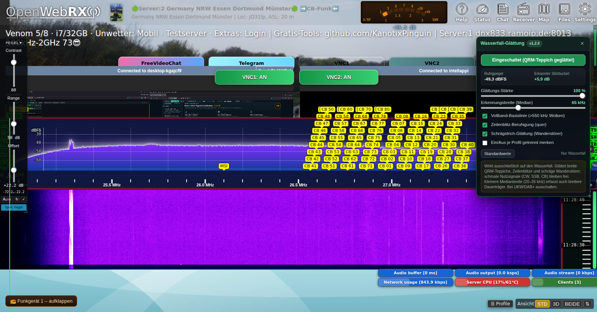
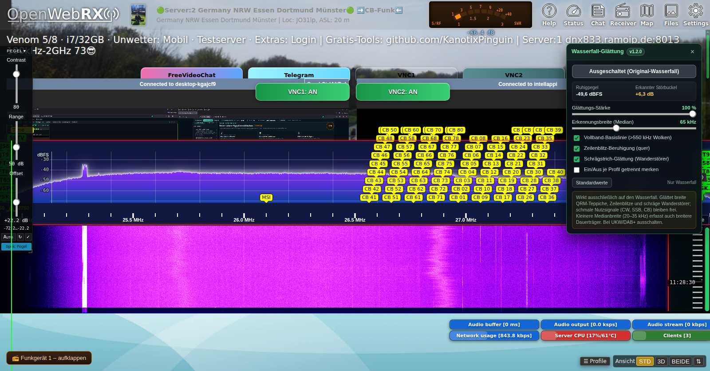
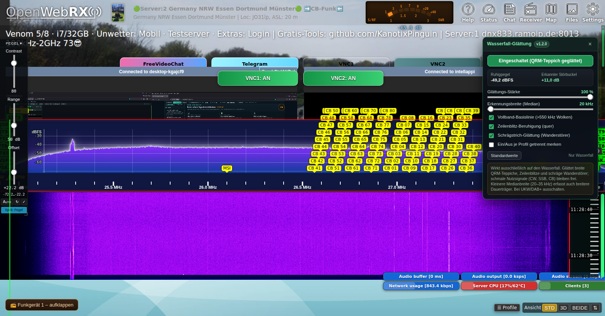
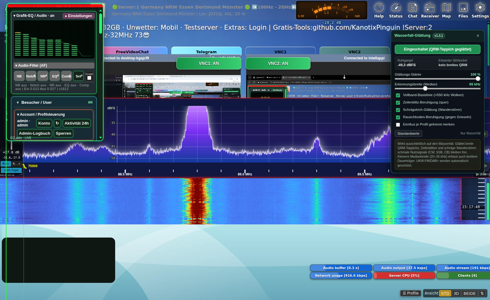

# DNX Wasserfall-Glättung (`v1.3.1`)

Eigenständiges, schaltbares OpenWebRX / OpenWebRX+ Receiver-Plugin (**Variante 2b+**: Vollband-Basislinie + Zeilenblitz-, Schrägstrich- & Rauschboden-Glättung) zur Beruhigung schmaler und sehr breiter Störteppiche (`50–200 kHz`-Buckel sowie `>550 kHz` / `1–2 MHz`-Störwolken), waagerechter Zeilenblitze, schräg durch das Band laufender Wanderstörungen (**Schrägstriche / Chirps / Schaltnetzteil-Drifts**) sowie von unruhigem Rauschboden-Grieseln **ausschließlich im Wasserfall**.

---

## Wichtiger Hinweis / Vollständige Distanzierung (Hobby-Mod-Mode)

- **Vollständige Distanzierung:** Ich distanziere mich vollständig vom Projekt *OpenWebRX / OpenWebRX+* sowie dessen Entwicklern und Betreibern. Es besteht keinerlei Verbindung, Zusammenarbeit oder Befürwortung.
- **Keine öffentlichen/offiziellen OpenWebRX-Plugins (nur Mod-Mode):** Dieses Paket ist ausdrücklich kein offizielles oder öffentliches Plugin von OpenWebRX, sondern ausschließlich eine private, inoffizielle Mod-Mode-Erweiterung.
- **Kein öffentlicher Support & keine Haftung:** Es gibt keinen öffentlichen Support, keine Garantie und keine Haftung. Nutzung und Installation erfolgen vollständig auf eigene Gefahr.
- **Reines Hobbyprojekt – frei verfügbar:** Erstellt aus reinem Hobby und Interesse am gemeinsamen Funk-/SDR-Hobby – frei verfügbar zum Nutzen, Weiterverbreiten, Verändern und Verbessern (`MIT`).

---

## Live-Vorschau (Vorher / Nachher)

| Zustand | Beschreibung |
| --- | --- |
|  | **AN (`65 kHz`, Vollband-Basislinie + Zeilenblitz-Beruhigung):** Der `~1,6 MHz` breite Störteppich (`25,35–26,90 MHz`) wird vollständig auf den ruhigen Bandboden (`-50,7 dBFS`) eingeebnet; schmale Signale und das Spektrum bleiben unverändert. |
|  | **AUS (Original-Wasserfall):** Dieselbe Situation ohne Glättung – breiter QRM-Teppich und horizontale Zeilenstörungen überstrahlen die Bandhälfte. |
|  | **AN (`20 kHz` Erkennungsbreite):** Schiebt man die Erkennungsbreite nach links auf `20–35 kHz`, werden zusätzlich auch breitere Dauerträger (`~20 kHz`) heruntergedrückt, während schmale SSB-/CW-/CB-Nutzsignale frei bleiben. |
|  | **Live auf Server 113 (`v1.3.1` Menü & UKW-Schutz):** Aktuelles UI-Panel mit *Rauschboden-Beruhigung (gegen Grieseln)* sowie aktivem Breitbandschutz für UKW-FM (`88–90 MHz`) und DAB+. |

---

## Funktionsprinzip (Variante 2b+)

1. **Schneller gleitender Median (`20–150 kHz`, Standard `65 kHz`)**
   - Folgt Störbuckeln und breiten QRM-Flächen, läuft aber **unter schmalen Nutzsignalen (`CW`, `FT8`, `SSB`, `AM`, `NFM`, `CB`) hindurch**.
   - **Tipp:** Bei `65 kHz` bleiben Signale bis ca. `30 kHz` Breite unberührt. Mit kleinerer Einstellung (`20–35 kHz`) lassen sich zusätzlich breitere Dauerträger (z. B. `20 kHz`-Störer) glätten; bei `100–150 kHz` werden auch sehr breite Nutzsignale geschützt.
2. **Innenband-Basislinie + Vollband-Anker (`>550 kHz`-Wolken)**
   - Neben dem lokalen `550 kHz`-Quartil (`p25`) bestimmt ein schneller Sortierlauf das ruhige Grundniveau (`p15`) über die inneren `80 %` des Spektrums.
   - Der SDR-Filterabfall an den äußeren `10 %`-Bandrändern bleibt geschützt (wird nie künstlich angehoben), während `1–2 MHz` breite Störplateaus sauber auf den ruhigen Bandboden abgesenkt werden.
3. **Zeilenblitz-Beruhigung (`quer`)**
   - Stabilisiert den Vollband-Zielboden zeitlich (`EMA`, mit automatischem Reset bei Profil-/Bandwechsel oder Sprüngen `> 5 dB`), sodass waagerechte Breitband-Impulse über die gesamte Zeile unterdrückt werden.
4. **Schrägstrich-Glättung (`Wanderstörer`, seit `v1.2.0`)**
   - Erkennt schmale, schräg durch den Wasserfall laufende Linien (**Ionosonden-/Chirp-Sweeps, wandernde Schaltnetzteil-Störer**, ca. `1,5–95 kHz/Zeile`) anhand ihrer linearen Schrägspur über mehrere Zeilen und glättet sie sauber auf den lokalen Hintergrundboden herunter.
   - Ein Stationär-Schutz erkennt senkrechte Funksignale (`CW`, `SSB`, `FT8`, `CB`, `AM`, `NFM`) – selbst kurze `1`-Zeilen-Morsesignale und gekreuzte Nutzträger bleiben unangetastet.
5. **Signalerhaltende Rauschboden-Beruhigung (`neu in v1.3.0 / v1.3.1`)**
   - Beruhigt unruhiges Rauschboden-Grieseln ausschließlich im Rauschbereich über ein gegatetes 7-Tap-Frequenzfilter (`<= Basis + 3,5 dB`) kombiniert mit einer asymmetrischen zeitlichen EMA (`0,40 / 0,60`) und weichem Übergang (`+2,2..3,8 dB`).
   - Echte schmale Nutzsignale oberhalb des Rauschbodens behalten ihren vollen Kontrast und verschmieren weder beim Ein- noch beim Ausschalten (inkl. sofortigem *just-quiet*-Snap ohne Nachleucht-Fahne).
6. **Breitband-Schutz (`UKW-FM` / `DAB+`) & Styler-Startschutz (`v1.3.0 / v1.3.1`)**
   - `UKW-FM (WFM)` und `DAB+` werden automatisch erkannt (`isWideBroadcast()`) und von Block-Subtraktion und Schrägstrich-Glättung ausgenommen, sodass starke UKW-Sender und DAB+-Blöcke ihre volle Dynamik behalten.
   - Wenn `DNX Styler` die Glättung beim Seitenstart automatisch einschaltet, bleibt das Einstellungsfenster geschlossen (`publicTogglePanel`) und öffnet sich erst bei echtem Benutzerklick.
7. **Sofort-Neumalen & komplette Entkopplung**
   - Beim Ein-/Ausschalten oder Verschieben der Regler wird der gesamte gepufferte Wasserfall (`__dnxWfHist` bzw. eingebauter Fallback-Puffer) sofort neu gezeichnet.
   - **Standard beim ersten Laden: AUS (`enabled: false`).**
   - **100 % getrennt:** Spektrum, `Spek: Pegel`, `RF-Gain`, `S-Meter`, `Scanner`, `Audio` und alle Server-Profile (`settings.json`) bleiben **völlig unverändert**.

---

## Changelog

- **v1.3.1:** Start-Popup-Schutz (`publicTogglePanel`), sodass das Einstellungsmenü beim automatischen `DNX Styler`-Start geschlossen bleibt und erst bei Benutzerklick öffnet; bereinigte UI-Hinweise und konsistente Versionierung.
- **v1.3.0:** Signalerhaltende Rauschboden-Beruhigung (`floorPolish`: gegatetes 7-Tap-Filter + asymmetrische EMA + *just-quiet*-Snap ohne Key-up-Fahne) sowie automatischer Breitbandschutz (`isWideBroadcast`) für `UKW-FM` und `DAB+`.
- **v1.2.0:** Schrägstrich-Glättung (*Wanderstörer*) mit Stationär-Schutz für `CW`, `SSB`, `FT8` und `CB`.
- **v1.1.0:** Vollband-Basislinie (`>550 kHz`-Wolken), Zeilenblitz-Beruhigung (`quer`), Erkennungsbreite `20–150 kHz` und höchste Panel-Ebene (`z-index: 2147483647`).
- **v1.0.0:** Erstveröffentlichung mit schnellem gleitendem Median, Sofort-Neumalen, Toolbar-Pille + Zahnrad und `DNX Styler`-Anbindung.

---

## Bedienung

- **Toolbar-Pille (`WF-Glättung: Aus / An ⚙`)**: Klick auf die Pille schaltet die Glättung ein/aus und öffnet bzw. schließt gleichzeitig das Einstellungsfenster; Klick auf das **Zahnrad** (oder Rechtsklick) öffnet/schließt das Menü unabhängig.
- **Standalone-Betrieb (ohne DNX Styler)**: Falls keine DNX-Werkzeugleiste vorhanden ist, erscheint nach `3,5 s` automatisch ein schwebender Schalter unten rechts.
- **DNX-Styler-Anbindung**: Über `window.dnxWfGlaettung` (`version`, `isEnabled`, `setEnabled`, `togglePanel`, `isPanelOpen`, `repaint`, `getStats`, `getConfig`) nahtlos angebunden.

---

## Installation

### Docker / Auto-Erkennung
```bash
sudo bash install.sh install
```

### Native OpenWebRX-Installation
```bash
sudo TYP=normal PLUGINS=/pfad/zu/plugins/receiver bash install.sh install
```

### Update, Status & Deinstallation
```bash
sudo bash install.sh update
sudo bash install.sh status
sudo bash install.sh uninstall
```

---

## Paketinhalt
- `files/dnx_wf_glaettung.js` — Plugin-Logik, DSP-Glättung & UI-Panel (`v1.3.1`)
- `files/dnx_wf_glaettung.css` — Styling (`z-index: 2147483647 !important`)
- `install.sh` — Universal-Installer (Docker & nativ)
- `loader-example.js` — Beispiel-Snippet für manuelles Laden in `plugins/receiver/init.js`
- `docs/` — Live-Screenshots (`Vorher/Nachher`, `20 kHz`-Modus, `Server 113 v1.3.1`)
- `SHA256SUMS.txt` & `LICENSE` (`MIT`)
